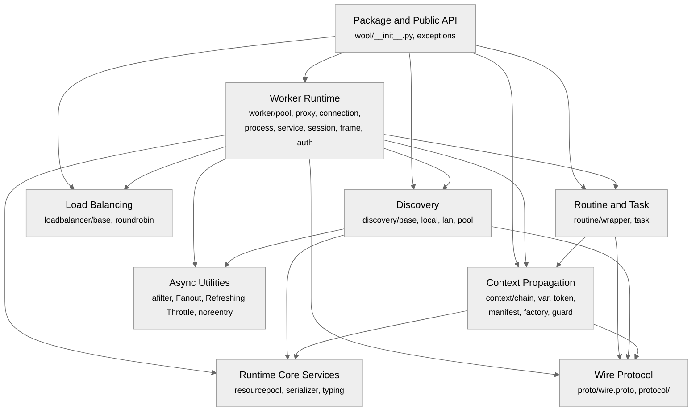
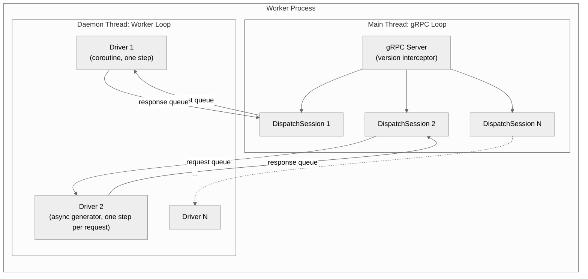
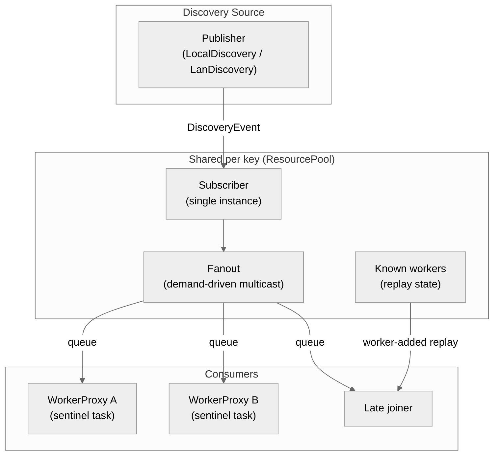
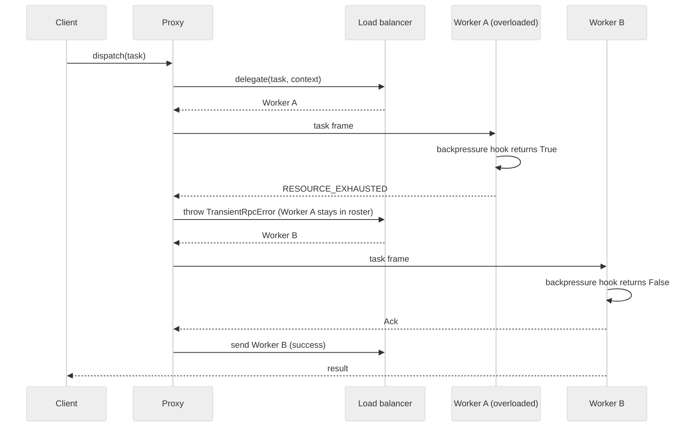

# Wool: A Lightweight Distributed Execution Runtime for Python

**Conrad Bzura, November 2026**

This document is a technical reference for the Wool distributed Python runtime. It is a handbook for Wool users with low-level system questions, engineers evaluating Wool as a backend for distributed Python applications, and contributors to the Wool core. It is not an introduction to Wool; for that, refer to the project's [README](https://github.com/wool-labs/wool/blob/main/README.md). Source paths are given relative to `wool/src/wool/`.

## Abstract

This paper presents Wool, a distributed Python runtime that extends Python's native async execution model across process boundaries. Wool is a composable execution primitive: it does not impose any workflow model, orchestration engine, or state management layer. It provides a minimal set of structural protocols that integrate with Python's existing async semantics, including coroutines, async generators, context variables, and exception propagation. The design prioritizes efficiency, composability, and simplicity, and distribution is expressed through source-level annotations, with no broker infrastructure, external configuration, or deployment manifest. Workers form a peer-to-peer network with no scheduler or control plane, and execution is best-effort and at-most-once. This paper describes the architecture, protocols, and implementation of Wool, with particular attention to the tradeoffs that follow from its position as a focused execution layer.

## Contents

- [1. Introduction](#1-introduction)
  - [1.1 Motivation](#11-motivation)
  - [1.2 Design Goals](#12-design-goals)
  - [1.3 System Scope](#13-system-scope)
- [2. Related Systems](#2-related-systems)
- [3. Architecture Overview](#3-architecture-overview)
  - [3.1 Concepts](#31-concepts)
  - [3.2 Components](#32-components)
  - [3.3 Resource Caching](#33-resource-caching)
- [4. Wire Protocol](#4-wire-protocol)
  - [4.1 Service Definition](#41-service-definition)
  - [4.2 Message Schema](#42-message-schema)
  - [4.3 Dispatch Sequence](#43-dispatch-sequence)
  - [4.4 Serialization](#44-serialization)
  - [4.5 Protocol Version Compatibility](#45-protocol-version-compatibility)
  - [4.6 Transport Errors and Cancellation](#46-transport-errors-and-cancellation)
- [5. Execution Model](#5-execution-model)
  - [5.1 Task Lifecycle](#51-task-lifecycle)
  - [5.2 Async Generator Streaming](#52-async-generator-streaming)
  - [5.3 Worker Thread Model](#53-worker-thread-model)
  - [5.4 Self-Dispatch](#54-self-dispatch)
  - [5.5 Exception Propagation](#55-exception-propagation)
  - [5.6 Error Classification](#56-error-classification)
- [6. Context Propagation](#6-context-propagation)
  - [6.1 The Chain](#61-the-chain)
  - [6.2 Variables and Tokens](#62-variables-and-tokens)
  - [6.3 Forking and Ownership](#63-forking-and-ownership)
  - [6.4 Wire Propagation](#64-wire-propagation)
  - [6.5 Serialization Failures](#65-serialization-failures)
  - [6.6 Runtime Options](#66-runtime-options)
  - [6.7 Cost Model](#67-cost-model)
- [7. Worker Discovery](#7-worker-discovery)
  - [7.1 Protocol Design](#71-protocol-design)
  - [7.2 LocalDiscovery](#72-localdiscovery)
  - [7.3 LanDiscovery](#73-landiscovery)
  - [7.4 Subscriber Sharing](#74-subscriber-sharing)
  - [7.5 Self-Describing Workers](#75-self-describing-workers)
  - [7.6 Filtered Discovery](#76-filtered-discovery)
- [8. Load Balancing](#8-load-balancing)
  - [8.1 Protocol](#81-protocol)
  - [8.2 Default Implementation](#82-default-implementation)
  - [8.3 Backpressure Integration](#83-backpressure-integration)
  - [8.4 Extension Points](#84-extension-points)
- [9. Worker Pool Composition](#9-worker-pool-composition)
  - [9.1 Pool Modes](#91-pool-modes)
  - [9.2 Tags and Filtering](#92-tags-and-filtering)
  - [9.3 Leases and Quorum](#93-leases-and-quorum)
  - [9.4 Nested Pool Propagation](#94-nested-pool-propagation)
  - [9.5 Admission Gate](#95-admission-gate)
- [10. Transport Security](#10-transport-security)
  - [10.1 Transport Modes](#101-transport-modes)
  - [10.2 Credential Resolution and Rotation](#102-credential-resolution-and-rotation)
  - [10.3 Peer Identity](#103-peer-identity)
  - [10.4 Credential Propagation](#104-credential-propagation)
- [11. Resource Cache Instances](#11-resource-cache-instances)
- [12. Design Decisions and Tradeoffs](#12-design-decisions-and-tradeoffs)
- [13. Conclusion](#13-conclusion)

## 1. Introduction

### 1.1 Motivation

The Python ecosystem offers several mature frameworks for distributed execution, including Celery, Ray, Prefect, Dask, and Dramatiq. These systems address well-understood problems, and their adoption is evidence of their value. They share a common architectural pattern: distributed execution is coupled with orchestration, state management, retry logic, and task scheduling. A developer who wants to execute a function on a remote process must generally adopt a programming model that imposes structure well beyond the execution concern itself.

This coupling raises a barrier for use cases that do not require orchestration. Many distributed workloads need only the ability to execute a function on another process and retrieve its result, without persistent state, retry policies, or centralized scheduling.

Wool provides that capability as a standalone primitive. It takes the position that Python's existing async semantics are sufficient to express distributed workflows once they are augmented with inter-process dispatch. Wool adds the dispatch layer and leaves everything else to the developer, who understands the workload and its infrastructure better than a general-purpose framework can.

### 1.2 Design Goals

Two principles drive Wool's architecture. The first is API simplicity. The second is composability, which here has a specific meaning: core extension points are structural protocols, so each can be replaced independently without coupling to Wool's internal class hierarchy. The system goals are low dispatch overhead and horizontal scalability through decentralized coordination. Wool gives up at-least-once delivery, distributed state management, and centralized scheduling to preserve these goals. Such properties are application-level concerns whose best implementation depends on the workload, and embedding them in the execution layer would constrain the workflows Wool can support.

A Wool programmer expresses logic with standard Python async primitives while the runtime manages physical placement. A distributed program and its single-process equivalent differ by a decorator (`@wool.routine`) and a context manager (`WorkerPool`). Removing both annotations from a distributed program produces a working local program; adding them to a local program distributes it. This symmetry is the central design goal.

### 1.3 System Scope

Wool distributes Python async functions and async generators across pools of worker processes. It provides worker lifecycle management, pluggable service discovery, client-side load balancing, bidirectional streaming over gRPC, propagation of context variables across process boundaries, and transport security. It does not provide a distributed object store, a centralized scheduler, a workflow engine, retry policies, task persistence, or an actor model. Users who need these compose them externally.

## 2. Related Systems

Distributed systems for Python span a broad design space, and Wool occupies a narrow region of it. This section describes what the neighboring systems offer and closes with how Wool differs.

Python's built-in parallelization mechanisms, the `multiprocessing` module and `concurrent.futures`, provide process-level parallelism with call-site RPC semantics: the caller submits a callable and receives its result. They do not cross machine boundaries, they do not stream results, and they do not extend async generator semantics across processes.

Task queue systems such as Celery, Dramatiq, and Huey treat work as messages enqueued for eventual processing by a consumer. They pair remote execution with a middleware surface of message brokers, result backends, task registries, and retry policies, and in exchange they offer persistence, retries, and dead-letter handling as configuration.

Distributed computing frameworks, notably Ray and Dask, are comprehensive platforms with their own object stores, schedulers, and programming models. Ray treats actors, objects, and tasks as first-class concepts, with distributed memory management and reference counting across a cluster. Dask constructs task graphs and coordinates them through a centralized scheduler. Both offer integrated resource management and data locality.

Actor frameworks such as Erlang/OTP, Akka, and Pykka organize computation around stateful, long-lived actors that communicate by message passing. They provide supervision trees, fault isolation, and location-transparent addressing as core abstractions.

Workflow engines such as Airflow, Prefect, and Temporal manage graph-based workflows with persistence, scheduling, and monitoring. Temporal adds durable execution guarantees.

Wool's unit of distribution is a function invocation. A caller awaits a routine and receives its result, or iterates a stream of results, as it would for a local call; nothing is enqueued, no broker intermediates, and no scheduler observes the cluster. Relative to `concurrent.futures`, Wool retains the call-site semantics and adds network transport, bidirectional streaming, context propagation, and pluggable discovery. Relative to every other system above, it removes facilities: persistence, retries, object stores, supervision, and workflow state are absent from the core. The relationship to workflow engines is complementary, since an engine decides what runs and when, and Wool decides where and how a callable executes. Some of the missing facilities can be approximated with Wool's existing extension points. Worker-scoped state, a sticky load balancer, and application-level supervision yield actor-like behavior, and custom discovery predicates approximate locality-aware placement. Support for such patterns may be formalized in future work, and it will remain an optional layer above the runtime.

## 3. Architecture Overview

### 3.1 Concepts

Five concepts form the mental model of a Wool application: routines, workers, discovery, worker pools, and load balancing.

A **routine** is an async function or async generator marked as distributable. Marking a function changes where it runs and leaves its signature, return type, and calling convention alone. A single invocation of a routine is a **task**: a self-contained description of the call that can be shipped to another process and executed there. Tasks nest, because a routine running on a worker can itself call routines.

A **worker** is a process that accepts tasks and executes them. Workers are general-purpose and interchangeable: a worker executes whatever callable it is sent and holds no task-specific registration. Workers are also peers. Each one is a server that accepts tasks and a potential client that dispatches nested tasks to other workers, so the network has no distinguished node.

**Discovery** is how workers become known. A worker announces itself under a namespace, and any process that subscribes to that namespace learns of the worker's arrival, changes, and departure. Discovery carries only advertisements. It does not route tasks, and it holds no authority over the workers it lists.

A **worker pool** is the set of workers a caller is willing to dispatch to. It is a declarative grouping that emerges from discovery: a namespace plus a predicate selects some workers, and that selection exists only from the caller's perspective. Two callers can hold different, overlapping pools over the same workers, and no worker knows which pools include it. Pools are therefore decoupled from worker management. A pool may also spawn workers for its own use, which is a convenience layered on the same model.

**Load balancing** is the caller-side choice of which pooled worker receives a given task. Each caller balances independently over its own view of the pool. There is no global queue and no shared view of load; a worker that is saturated says so when asked, and the caller moves on to the next candidate.

Together these give a system in which a caller discovers peers, selects one, and speaks to it directly. The remainder of this section maps the concepts to their concrete components.

### 3.2 Components

Wool's runtime has six components: the routine decorator, the worker pool, the worker proxy, a discovery service, a load balancer, and one or more workers. The first three are fixed parts of the runtime. The discovery service, load balancer, and worker are each defined by a structural protocol (`DiscoveryLike`, `LoadBalancerLike`, and `WorkerLike`) and can be replaced independently.

**The routine decorator.** `@wool.routine` applies to async functions and async generators. Calling a decorated function constructs a `Task`, a serializable envelope holding the callable, its arguments, and a reference to the current `WorkerProxy`, and hands it to the proxy for dispatch. The decision to dispatch is governed by a context-scoped flag that the worker clears around the immediate callable: when a task arrives at a worker, the routine body runs locally, and any routine calls inside that body dispatch outward again. A routine call requires an active pool; there is no implicit local fallback. When combined with `@classmethod` or `@staticmethod`, `@wool.routine` must be the innermost decorator (`runtime/routine/wrapper.py`).

**The worker pool.** `WorkerPool` is an async context manager that owns the lifecycle of a pool. On entry it resolves its mode from the `spawn` and `discovery` parameters, optionally spawns workers and publishes them to discovery, and creates a `WorkerProxy` wired to a discovery subscriber and a load balancer. On exit it announces the departure of its workers, stops them within a `shutdown_timeout` budget, and closes discovery. The `lease` parameter caps how many discovered workers the pool will admit. Pools are unbounded by default and consider every worker that matches the discovery namespace and predicate. The pool manages lifecycle and wiring and takes no part in dispatch (`runtime/worker/pool.py`).

**The worker proxy.** `WorkerProxy` connects application code to the available workers. A background sentinel task consumes the discovery stream, applies an admission gate to each advertised worker (Section 9.5), and maintains the roster of admitted workers. Each roster entry pairs the worker's metadata with a `WorkerConnection`, which is a lazy handle: the underlying gRPC channel is opened on first dispatch, shared through a reference-counted cache, and closed after a brief idle period. On dispatch, the proxy asks the load balancer for a candidate, attempts the dispatch itself, and reports the outcome back to the balancer. The proxy is lazy by default and defers discovery subscription and sentinel startup until its first dispatch. It is also serializable under Wool's pickler: its reduction carries the discovery subscriber, load balancer, identifier, and admission settings, which is how a nested routine call on a remote worker reconnects to its originating pool (`runtime/worker/proxy.py`).

**Discovery.** The `DiscoveryLike` protocol composes a publisher, which broadcasts worker lifecycle events, and a subscriber, which yields them as an async stream. Wool ships `LocalDiscovery`, a file-backed registry for single-host pools, and `LanDiscovery`, which uses DNS-SD over Zeroconf. Both are scoped by a namespace string. A deployment that already runs a service registry such as Consul or etcd can supply a conforming backend without inheriting from any Wool class. A publisher is not strictly required: a pool that only consumes externally managed workers needs a subscriber alone, provided the registry already holds worker metadata (`runtime/discovery/`).

**The load balancer.** `LoadBalancerLike` requires one method, `delegate(task, *, context)`, an async generator that yields candidate worker identifiers. The balancer selects; the proxy dispatches. After each yield the proxy either sends the identifier back to signal success or throws the failure into the generator to request another candidate. Because the roster is passed in as a read-only view, a balancer holds no pool state of its own beyond what its strategy needs. Wool ships `RoundRobinLoadBalancer` as the default (`runtime/loadbalancer/`).

**Workers.** `WorkerLike` is a process-management interface: `start`, `stop`, and the worker's `uid`, `address`, `tags`, `extra`, and `metadata`. It describes how a pool launches and retires a worker, and it is not a hook into task execution. The default implementation, `LocalWorker`, spawns a `WorkerProcess` subprocess that hosts a gRPC server and a `WorkerService`. `WorkerProcess` installs the state that task execution depends on, including the version interceptor, the context task factory, the credential scope, and the cache of nested-dispatch proxies. Authors of custom workers are strongly encouraged to wrap `WorkerProcess` and vary only how and where it is launched (`runtime/worker/base.py`, `runtime/worker/local.py`, `runtime/worker/process.py`, `runtime/worker/service.py`).

The following diagram shows how these components interact across the four phases of a pool's lifetime.

```mermaid
%%{init: {'theme': 'neutral'}}%%
sequenceDiagram
    participant Client
    participant Routine
    participant Pool
    participant Discovery
    participant Proxy
    participant Balancer as Load balancer
    participant Worker

    %% -- 1. Pool startup --
    rect rgb(0, 0, 0, 0)
        Note over Client, Worker: Worker pool startup

        Client ->> Pool: enter pool (spawn, discovery, loadbalancer)
        activate Client
        Pool ->> Pool: resolve mode from spawn and discovery

        opt If spawn specified
            loop Per worker
                Pool ->> Worker: start worker
                Worker ->> Worker: start process, bind gRPC server
                Worker -->> Pool: worker metadata
                Pool ->> Discovery: publish "worker-added"
            end
        end

        Pool ->> Proxy: create proxy (subscriber, load balancer)
        opt Eager proxy now, lazy proxy on first dispatch
            Proxy ->> Proxy: start sentinel, await quorum
        end
        Pool -->> Client: pool ready
        deactivate Client
    end

    %% -- 2. Discovery --
    rect rgb(0, 0, 0, 0)
        Note over Discovery, Proxy: Worker discovery (proxy sentinel task)

        loop Per worker lifecycle event
            Discovery -->> Proxy: DiscoveryEvent
            alt worker-added or worker-updated
                Proxy ->> Proxy: admission gate (security, version, identity)
                alt Admitted
                    Proxy ->> Proxy: add or refresh roster entry
                else Rejected
                    Proxy ->> Proxy: ignore, or evict if held
                end
            else worker-dropped
                Proxy ->> Proxy: remove entry, close connection
            end
        end
    end

    %% -- 3. Task dispatch --
    rect rgb(0, 0, 0, 0)
        Note over Client, Worker: Task dispatch

        Client ->> Routine: await routine
        activate Client
        Routine ->> Routine: create task
        Routine ->> Proxy: dispatch(task)

        loop Until acknowledged or candidates exhausted
            Proxy ->> Balancer: next candidate
            Balancer -->> Proxy: worker uid
            Proxy ->> Worker: open stream, write task frame
            alt Ack
                Worker -->> Proxy: Ack
                Proxy ->> Balancer: report success
            else Nack (task could not be parsed)
                Worker -->> Proxy: Nack with original exception
                Proxy -->> Client: re-raise
            else Transient error or handshake failure
                Proxy ->> Balancer: report failure, keep worker
            else Non-transient error
                Proxy ->> Proxy: evict worker
                Proxy ->> Balancer: report failure
            end
        end
        opt Candidates exhausted
            Proxy -->> Client: raise NoWorkersAvailable
        end

        alt Coroutine
            Routine ->> Worker: next frame + caller context
            Worker ->> Worker: run coroutine
            Worker -->> Routine: result + worker context
            Routine -->> Client: return result
        else Async generator
            loop Each iteration
                Client ->> Routine: next / send / throw
                Routine ->> Worker: request frame + caller context
                Worker ->> Worker: advance generator one step
                Worker -->> Routine: result + worker context
                Routine -->> Client: yield result
            end
        else Exception
            Worker -->> Routine: serialized exception + worker context
            Routine -->> Client: re-raise
        end
        deactivate Client
    end

    %% -- 4. Teardown --
    rect rgb(0, 0, 0, 0)
        Note over Client, Worker: Worker pool teardown

        Client ->> Pool: exit pool
        activate Client
        Pool ->> Proxy: stop proxy
        Proxy ->> Proxy: cancel sentinel

        opt Stop spawned workers
            loop Per worker
                Pool ->> Discovery: publish "worker-dropped"
                Pool ->> Worker: stop (grace)
                Worker ->> Worker: drain or cancel tasks, exit process
            end
        end

        Pool ->> Discovery: close discovery
        Pool -->> Client: pool exited
        deactivate Client
    end
```



*Figure 1. Pool lifecycle and task dispatch. The pool spawns workers, publishes them to discovery, and creates a proxy. The proxy's sentinel consumes discovery events and maintains the roster of admitted workers. On dispatch, the proxy asks the load balancer for candidates and attempts each in turn until one acknowledges the task. Results return over the same bidirectional stream, each frame carrying the sender's context snapshot.*

The following diagram shows the principal static dependencies between Wool's subsystems, as derived from the import graph. Arrows read "depends on".



*Figure 2. Principal subsystem dependencies. The Worker Runtime is the most connected subsystem and depends on every other. Discovery, Context Propagation, and Routine and Task are peers above the shared core services and the wire protocol. The layering is not strict: subsystems also reach process-wide state declared in the package root, and the discovery and load-balancing contracts reference the worker metadata and connection types.*

### 3.3 Resource Caching

A distributed runtime holds resources that are expensive to create and wasteful to keep: gRPC channels with their HTTP/2 connections and file descriptors, discovery subscriptions with their filesystem watchers or mDNS browsers, and event loops with their threads. Creating one per task would dominate dispatch cost. Holding them indefinitely leaks descriptors in a system where the set of peers changes continuously. The efficiency goal of Section 1.2 depends on resolving this tension, and Wool resolves it once, with a reference-counted cache that every subsystem reuses.

The cache is `ResourcePool`. A pool is constructed with a factory that builds a resource for a key, an optional finalizer that tears it down, and a time-to-live. A caller leases a resource with `async with pool.get(key)`. The first lease for a key invokes the factory, and concurrent leases for the same key share the one resource. When the last lease ends, the resource lingers for the time-to-live and is then finalized; a new lease within that window cancels the pending finalization. Bursty workloads, which release and re-acquire the same resource in quick succession, therefore pay construction cost once per burst.

Resources such as channels and queues are bound to the event loop that created them, and Wool runs more than one loop per process (Section 5.3). `ResourcePool` partitions its entries by event loop, so a resource is never shared across loops and each loop's entries are finalized on that loop. A lease released from a foreign loop is handed back to its owning loop. Beyond leasing, a pool supports explicit expiry of one key or all keys, which finalizes each entry as soon as it is unreferenced, and a forced `clear` for shutdown.

`ResourcePool` and its lease handle `Resource` are exported from the `wool` package. Section 11 lists the six instances the runtime creates (`runtime/resourcepool.py`).

## 4. Wire Protocol

### 4.1 Service Definition

The `Worker` gRPC service exposes three RPCs: a bidirectional streaming `dispatch`, a unary `stop`, and a unary `idle`.

```protobuf
service Worker {
    rpc dispatch (stream Request) returns (stream Response);
    rpc stop (StopRequest) returns (Void);
    rpc idle (Void) returns (Idle);
}
```

`dispatch` is bidirectional for two reasons. The response side must be a stream because every dispatch begins with a handshake: the worker's first response either accepts the task or rejects it, on grounds of version or security incompatibility, a task it cannot parse, or backpressure, before any result exists. The request side must be a stream because an async generator is driven interactively, with the caller sending one command per step. A server-streaming RPC would suffice for coroutines, but a single endpoint for both routine kinds is simpler to reason about and maintain, so coroutines use the same stream and send a single command.

`stop` is unary because shutdown is a one-shot command. Its `StopRequest` carries a grace period whose sign selects the behavior: zero cancels in-flight tasks immediately, a positive value waits that long for them to finish before cancelling the remainder, and a negative value waits indefinitely. `idle` reports how long the worker has been continuously idle, measured on a monotonic clock from the moment its set of in-flight tasks last emptied, and zero while any task is in flight. It is a primitive for external autoscalers and reapers; nothing inside Wool consumes it (`wool/proto/wire.proto`).

### 4.2 Message Schema

The `Task` message is the initial payload of every dispatch. Its first four fields, `version`, `id`, `caller`, and `tag`, form an envelope that can be parsed on its own through the `TaskEnvelope` message, which declares only those fields under the same field numbers. Because Protocol Buffers skips unknown fields, parsing a full `Task` byte string as a `TaskEnvelope` skips the potentially heavy payload fields and returns only the metadata. The envelope serves a second purpose: the rest of a task from an incompatible client may have a shape the worker cannot deserialize, and reading the version first lets the worker return a clear incompatibility error in place of an opaque deserialization failure.

The remaining fields carry the executable material. `callable`, `args`, and `kwargs` hold the serialized function and its arguments. `proxy` holds the serialized `WorkerProxy` through which the task was dispatched, and `proxy_id` its identifier. `runtime_context` carries the caller's runtime options, at present the dispatch timeout (Section 6.6). A `timeout` field is reserved and is not enforced by the current runtime.

The `Request` message wraps a `oneof payload` with four alternatives: `task` opens a dispatch, `next` advances the routine, `send` passes a value into a generator, and `throw` raises an exception inside it. The `Response` message mirrors it with `ack` (task accepted, with the worker's protocol version), `nack` (task rejected during parsing, with the original exception serialized inside), `result` (a returned or yielded value), and `exception` (an error raised by the routine). The `send`, `throw`, `result`, `exception`, and `nack` payloads each carry a `Message` whose `dump` field holds a serialized Python object.

Both `Request` and `Response` carry a second field beside the payload: `context`, a `ChainManifest` holding the sender's snapshot of its context variables. It rides on every `next`, `send`, `throw`, `result`, and `exception` frame, and is absent from the `task`, `ack`, and `nack` frames that bound the handshake. Section 6.4 describes its contents.

On the worker and the caller, protobuf envelopes are decoded into a `Frame` hierarchy, one class per payload alternative, which gives each side a typed view of the payload and a single `mount` operation that applies a frame's context manifest (`runtime/worker/frame.py`).

### 4.3 Dispatch Sequence

A dispatch has a handshake phase and a streaming phase.

On the caller, `WorkerConnection.dispatch` resolves the channel key for the target worker, leases the channel from the channel cache, and then, within the dispatch timeout, acquires one of the channel's stream permits, opens the call, writes the task frame, and reads one response. The channel key is the tuple of target address, credentials, channel options, and pinned peer name. Credentials are resolved on every dispatch, so rotated material produces a new key and retires the old channel.

On the worker, the first request passes through five stages in order:

1. **Version check.** The `VersionInterceptor` reads the envelope and aborts incompatible clients (Section 4.5).
2. **Shutdown gate.** A worker that is stopping aborts with `UNAVAILABLE`.
3. **Parse.** The `DispatchSession` deserializes the task and checks that the callable is a coroutine function or an async generator function. Any failure here is returned as a lone `Nack` carrying the exception.
4. **Backpressure.** The worker decides whether to apply backpressure, and if so aborts with `RESOURCE_EXHAUSTED` (Section 8.3).
5. **Acknowledgment.** The session is recorded in the worker's set of in-flight tasks and an `Ack` is written.

The caller treats the `Ack` as the end of the handshake. A `Nack` is deserialized and its exception re-raised with its original class. Any other first response raises `UnexpectedResponse`.

The streaming phase is identical on the wire for both routine kinds. The caller writes a request frame and reads one response frame, and the worker advances the routine exactly one step per request. A coroutine is the one-step case: the caller writes a single `next`, and the worker replies with a single `result` or `exception`. The routine does not begin executing until the first `next` arrives, because that frame carries the caller's context. The stream ends when the routine returns or raises, when a generator is exhausted, or when either side cancels (`runtime/worker/connection.py`, `runtime/worker/service.py`, `runtime/worker/session.py`).

### 4.4 Serialization

Wool serializes in two layers. The outer layer is Protocol Buffers, which handles structure and framing: field tags, lengths, and the `oneof` discriminator are encoded in protobuf's binary format, so a message remains parsable across versions even when its inner payloads are opaque. The inner layer encodes Python objects: the `callable`, `args`, `kwargs`, and `proxy` fields of `Task`, every `Message.dump`, and every context variable value.

The inner layer is defined by the `Serializer` protocol, a hashable object with `dumps` and `loads`. One process-wide instance, `wool.__serializer__`, encodes all payloads in both directions. It is a `CloudpickleSerializer`, chosen because cloudpickle serializes closures, lambdas, and interactively defined functions that the standard `pickle` module cannot. Its pickler adds one extension: a type that defines `__wool_reduce__` controls its own transport form, and that hook takes precedence over the standard reduction protocol. `WorkerProxy`, `wool.ContextVar`, and `wool.Token` use the hook to travel inside dispatch payloads while refusing ordinary pickling and copying, which keeps objects that are meaningful only within a Wool dispatch from being serialized by accident elsewhere. Traceback serialization is enabled at import through `tblib` (`runtime/serializer.py`).

### 4.5 Protocol Version Compatibility

Wool guards against protocol incompatibility on both sides of a connection. On the worker, the `VersionInterceptor` inspects the first message of every `dispatch` stream and parses its task as a `TaskEnvelope`, reading the client's version without touching the payload bytes. A client is accepted if and only if its major version equals the worker's and its full version is less than or equal to the worker's, under PEP 440 ordering. A worker may be newer than its clients within a major release; the reverse is not permitted. An incompatible, empty, or unparsable version aborts the call with `FAILED_PRECONDITION`. The caller classifies that status as non-transient and evicts the worker from its roster.

On the caller, the proxy's admission gate applies the same rule to the version each worker advertises through discovery, so incompatible workers are normally excluded before any dispatch is attempted. The interceptor is the enforcement point; the gate is an optimization that relies on advertised data (`runtime/worker/interceptor.py`, `runtime/worker/proxy.py`).

### 4.6 Transport Errors and Cancellation

Failures and cancellations are handled differently in the two phases of a dispatch, and the boundary between them is the `Ack`.

**During the handshake**, a gRPC failure is classified by status code. `UNAVAILABLE`, `DEADLINE_EXCEEDED`, and `RESOURCE_EXHAUSTED` are transient: the proxy leaves the worker in its roster and tries the next candidate. A TLS failure, recognized as `UNAUTHENTICATED` or as `UNAVAILABLE` with TLS evidence in its details, is a handshake error; it is handled as transient and logged with a rate-limited warning. Every other status is non-transient and evicts the worker. Expiry of the dispatch timeout is reported as a local `DEADLINE_EXCEEDED` and is transient. The timeout bounds the wait for a stream permit and the handshake itself. It applies per attempt and does not bound routine execution. Section 5.6 tabulates these classes.

**After the handshake**, the task belongs to one worker and nothing is retried. A transport failure during streaming surfaces to the caller as the underlying gRPC error. This follows from at-most-once semantics: once a worker has acknowledged a task, the runtime cannot know how far execution progressed, so it does not attempt the task elsewhere.

**Caller-side cancellation** takes two forms with one mechanism. Cancelling the task that is awaiting a routine, and closing or abandoning a generator before exhaustion, both cancel the gRPC call; no frame is written. Teardown of the call, the stream permit, and the channel lease is shielded from further cancellation, so a cancelled caller still releases its permit. On the worker, the cancelled call triggers cancellation of the session's routine, which observes `CancelledError` at its current suspension point. The scope that hosts the routine then closes it, which runs the `finally` blocks of a generator body on the worker.

**Worker-side cancellation** originates from the `stop` RPC or from a signal. A stopping worker refuses new dispatches with `UNAVAILABLE` and treats in-flight tasks according to the grace period described in Section 4.1. `SIGTERM` is a stop with zero grace and `SIGINT` is a stop with indefinite grace. A worker whose parent process dies stops with zero grace and exits unconditionally after its shutdown grace period. A task cancelled by a stopping worker reaches its caller as a `CancelledError` on the exception channel, which the caller cannot distinguish from its own cancellation.

## 5. Execution Model

### 5.1 Task Lifecycle

When a caller awaits a routine, the call is packaged as a task and offered to a worker chosen by the caller's load balancer. The worker either rejects the task outright or accepts, unpacks, and executes it. Results are packaged and returned or streamed back to the caller according to the routine kind. If the routine raises, the exception is packaged, transmitted, and re-raised at the call site with its type and traceback intact. The stages follow.

**Invocation.** When a caller awaits a decorated function, the wrapper checks whether dispatch is active in the calling context. If it is, the wrapper takes the current `WorkerProxy` from the context variable `wool.__proxy__`, constructs a `Task`, and passes it to the proxy. The `Task` captures the callable, its positional and keyword arguments, a fresh UUID, the proxy, and a tag formed from the routine's module, qualified name, and definition line. It also records the identifier of the calling task when one is active, which links nested tasks to their parents, and the caller's runtime options, among other information. A call can bypass the ambient proxy: `WorkerPool.dispatch(routine, *args)` routes one call through a named pool, and nested calls made by that task on the worker route through the same pool (`runtime/routine/wrapper.py`, `runtime/routine/task.py`).

**Selection and transport.** The proxy asks the load balancer for a candidate worker and performs the handshake of Section 4.3 against that worker's `WorkerConnection`. The task is converted to protobuf with each payload field serialized individually. If the handshake fails with an `RpcError`, the proxy reports the failure to the balancer, which yields another candidate; the proxy, and not the balancer, decides whether the failed worker stays in the roster. When the balancer has no further candidates, the proxy raises `NoWorkersAvailable` (`runtime/worker/proxy.py`, `runtime/worker/connection.py`).

**Admission.** The worker runs the five stages of Section 4.3. A task that cannot be parsed is returned to the caller as its original exception and is not retried elsewhere. A task refused by backpressure or by a stopping worker is retried on the next candidate.

**Execution.** The worker runs the routine inside a scope that establishes its execution environment. The scope leases the task's proxy from the worker's proxy cache and installs it as the current proxy, so that nested routine calls have a pool to dispatch through. It enters the task's runtime options, marks the task as the current task so that nested tasks can record their caller, and clears the dispatch flag for the immediate callable. Each step of the routine then runs in a context that holds the caller's context variables, and the worker's snapshot of that context returns to the caller with each result (`runtime/routine/task.py`, `runtime/worker/session.py`).

### 5.2 Async Generator Streaming

Wool distributes async generator functions with the same decorator used for coroutines. Python's async generator protocol is interactive: the consumer drives iteration one step at a time with `anext()`, `asend()`, and `athrow()`. Wool preserves that interactivity across the process boundary with a pull-based stream in which each caller request produces at most one worker response.

The first advance of a remote generator is written as a `next` frame. Each later operation is written as a `send` frame carrying the sent value, with a plain `anext()` sending `None`, which matches the language's own equivalence between `anext()` and `asend(None)`. `athrow(exc)` is written as a `throw` frame carrying the serialized exception. For each frame, the worker advances the generator one step on its worker loop and writes back the yielded value or the raised exception. Exhaustion writes no frame: the worker closes the response stream, and the caller's generator ends. Because the worker does nothing between requests, neither side buffers, and a slow consumer slows the producer by construction.

Each frame in both directions carries the sender's context snapshot (Section 6.4). A caller that sets a context variable between iterations sees that value inside the next step of the remote generator, and a variable set inside the generator body is visible to the caller after the step returns.

Closing the generator early follows the cancellation path of Section 4.6. The wrapper closes the dispatch stream in a `finally` block, so breaking out of an `async for` loop over a remote generator releases the remote resources as it would for a local one (`runtime/routine/wrapper.py`, `runtime/worker/connection.py`).

### 5.3 Worker Thread Model

Each worker process runs two event loops to isolate gRPC I/O from routine execution. The gRPC server runs on the process's main loop, where it accepts streams, parses and acknowledges tasks, evaluates backpressure, and encodes responses. Routines run on a dedicated worker loop on a separate daemon thread. A CPU-bound step in a routine blocks only the worker loop; the main loop continues to accept dispatches, answer `idle` and `stop`, and observe cancellation.

The worker loop is itself a cached resource. It is created on the first dispatch, held while any task is in flight, and retired after thirty seconds without one. Retirement clears the loop's proxies, discovery subscriptions, and channels, cancels remaining tasks, stops the loop, and joins its thread within a bounded budget.

Each dispatch is handled by a `DispatchSession` that bridges the two loops with a pair of queues. The request queue is owned by the worker loop and receives raw request messages from the main loop. The response queue is owned by the main loop and receives response frames from the worker loop. A driver coroutine on the worker loop takes one request, decodes it, mounts its context manifest, advances the routine one step, snapshots the resulting context, and puts one response. Coroutines and async generators share this driver; a coroutine completes in one step. Scheduling of the driver is deferred until the stream is first iterated, which is after backpressure has been evaluated, so a rejected task never reaches the worker loop (`runtime/worker/service.py`, `runtime/worker/session.py`).



*Figure 3. Dual-loop worker architecture. The gRPC server handles concurrent dispatch streams on the main thread. Each stream's session bridges to a driver on the worker loop through a request queue and a response queue, and the driver advances the routine one step per request. CPU-bound work on the worker loop does not block gRPC I/O.*

Worker processes are started with the `spawn` method and are daemonic by default; a daemonic worker cannot create `multiprocessing` children of its own, and `daemon=False` lifts that restriction. A worker reports readiness by sending its serialized `WorkerMetadata` to its parent over a pipe.

### 5.4 Self-Dispatch

A routine running on a worker may dispatch a nested routine that the load balancer assigns back to the same worker. The dispatch still travels over gRPC, so that acknowledgment, streaming, context propagation, and cancellation behave identically for every placement, but the transport is cheapened. Where Unix domain sockets are available, each worker also listens on a socket in a private directory. When a connection's target address equals the address of the worker it is running in, the connection substitutes the socket for the TCP address, which removes TCP and TLS overhead for a hop that never leaves the process. The socket directory is created with owner-only permissions, and the route carries no credentials (`runtime/worker/connection.py`, `runtime/worker/process.py`).

### 5.5 Exception Propagation

When a routine raises, the worker serializes the exception with its traceback and writes it as the terminal `exception` frame. The caller deserializes it and re-raises the original object. For a coroutine the exception surfaces from the `await`; for an async generator it surfaces from the `anext()`, `asend()`, or `athrow()` that drove the failing step. Remote exceptions therefore carry their original type and traceback, and a caller's `except` clauses work unchanged.

An exception that cannot be serialized is degraded in stages so that the caller always receives something meaningful. The worker first tries the exception as it is, then a reconstruction from its class and arguments with a warning attached, then the same with attachments stripped, and finally a `RuntimeError` naming the original class and message. A result that cannot be serialized is converted to a `SerializationError` and delivered on the exception channel.

Two cases are delivered differently from an ordinary exception. A remote `CancelledError` is re-raised as such. Any other payload that is not an `Exception`, such as a `KeyboardInterrupt` raised inside a routine, is delivered as `UnexpectedResponse` with the original attached as context.

### 5.6 Error Classification

Wool sorts dispatch errors into classes that determine how the proxy and the caller respond.

| Error | Origin | Handling |
|---|---|---|
| `TransientRpcError` | Handshake fails with `UNAVAILABLE`, `DEADLINE_EXCEEDED`, or `RESOURCE_EXHAUSTED`; or the dispatch timeout expires | Proxy tries the next candidate; the worker stays in the roster |
| `HandshakeError` | Handshake fails with `UNAUTHENTICATED`, or `UNAVAILABLE` with TLS evidence | As transient, with a rate-limited warning per worker |
| `RpcError` | Handshake fails with any other status, including `FAILED_PRECONDITION` on version mismatch and `INTERNAL` | Proxy evicts the worker and tries the next candidate |
| Parse failure (original exception) | Worker returns a `Nack` | Re-raised to the caller; no retry, no eviction |
| `UnexpectedResponse` | A response does not match the protocol state | Raised to the caller |
| `NoWorkersAvailable` | The load balancer has no further candidates | Raised to the caller |
| Remote exception | Raised by the routine during execution | Re-raised at the caller with original type and traceback |
| gRPC error after `Ack` | Transport failure during streaming | Raised to the caller; no retry |

`HandshakeError` subclasses `TransientRpcError`, which subclasses `RpcError`. The central distinction is between transient and non-transient handshake failures. Transient failures, which include backpressure, leave the roster intact, so temporary conditions such as overload heal without intervention. Non-transient failures shrink the roster, so persistent faults such as protocol incompatibility are pruned after one attempt. TLS failures are kept on the transient side because they are recoverable: a worker may adopt rotated credentials out of band, and it should become usable again without rediscovery.

## 6. Context Propagation

Python's `contextvars` module gives async code implicit, task-scoped state with two rules: an `await` shares the caller's context with the callee, and `asyncio.create_task` gives the new task a copy. Wool extends both rules across the wire. Awaiting a routine shares the caller's Wool context variables with the remote body and merges the body's changes back, as a local `await` would. This section describes the subsystem that implements this (`runtime/context/`).

### 6.1 The Chain

A **chain** is one serial branch of the async call tree: the sequence of awaits descending from the most recent task fork, including any portion that executes on a worker. Wool represents it with `Chain`, an immutable record that indexes the Wool state of that branch. A `Chain` holds an identifier, the identity of the thread and task that own it, the set of variables bound on the branch, the set of variables that have been reset to no value, and per-variable ledgers of reset tokens.

The `Chain` is an index and holds no values. It lives in a single standard-library context variable, `wool.__chain__`, and each Wool variable's value lives in its own standard-library variable. Every mutation builds a new `Chain` and reinstalls it. Immutability is what lets the record be shared by reference across context copies, callbacks, and timers without intercepting the event loop: a mutation is visible only in the context that made it, which is the semantics `contextvars` already provides.

A context is **armed** once it contains a chain. Arming happens on the first `set` of a Wool variable or on receipt of a wire manifest that carries state, and it is permanent for that context. Every cost described below applies only to armed contexts.

### 6.2 Variables and Tokens

`wool.ContextVar` mirrors `contextvars.ContextVar` with one structural difference: identity. A standard variable is identified by its object, which is meaningless in another process. A Wool variable is identified by a `(namespace, name)` key, where the namespace defaults to the top-level package of the declaring code. The key is deliberately coarse so that it survives a module being moved within its package. A process-wide registry maps keys to variables, and declaring a second variable under an existing key raises `ContextVarCollision`.

`get`, `set`, and `reset` follow the standard semantics. `set` returns a `wool.Token`, and `reset` restores the variable to its value before the corresponding `set`. A token is single-use, and a second reset raises `RuntimeError`. Single use is enforced across processes: the chain's ledgers record which tokens are live and which are spent, the ledgers travel with every manifest, and the receiving side merges them. A token spent on a worker is therefore rejected at its origin.

Variables and tokens can be passed as routine arguments. A variable serializes as its key and default, never its value. A token serializes with enough state to be reset remotely, and the receiving side honors it only if the accompanying manifest lists it as live. The manifest acts as the witness because a payload may be pickled outside the context it is shipped from.

### 6.3 Forking and Ownership

Concurrent branches must not share a chain: two tasks mutating one chain would overwrite each other's bindings and could reset each other's tokens. Wool installs an asyncio task factory that enforces this. When a task is created from an armed context, the factory wraps its coroutine so that the new task begins by forking the chain. The fork keeps the bound variables, whose values the context copy already carries, and takes a fresh identifier and empty token ledgers. A child task therefore sees its parent's values and cannot reset its parent's tokens. Tasks created from unarmed contexts are not wrapped.

The factory composes with an existing task factory by wrapping it, and it is installed on pool entry, in each worker process, and on each worker loop. If other code later replaces it, the next operation that arms or mutates a chain raises `TaskFactoryDisplaced`.

`wool.to_thread` is the counterpart of `asyncio.to_thread`. It forks the chain on the executor thread, so offloaded work reads the caller's values under its own chain, and its mutations are not merged back.

Copy-on-fork cannot cover every path. A context can be shared while unarmed and armed later, a task can be constructed directly without the factory, and plain `asyncio.to_thread` copies the context without forking. A guard covers these cases. Every `get`, `set`, and `reset` first checks that the calling thread and task are the chain's owners, and raises `ChainContention` otherwise. The guard converts what would be silent corruption into an immediate error at the point of misuse.

### 6.4 Wire Propagation

A chain crosses the wire as a `ChainManifest`: the chain identifier and one entry per variable. An entry for a bound variable carries its serialized value. An entry for a variable that was reset to no value carries no value, which instructs the receiver to clear it. Each entry also carries that variable's live and spent token identifiers. Constructor defaults are never sent, and entries are emitted in sorted order, so encoding is deterministic.

Manifests ride on every frame of the streaming phase, in both directions (Section 4.2). The caller's first `next` frame delivers its chain to the worker, and the worker mounts it into the context in which the routine will run. After each step, the worker snapshots that context and attaches the manifest to the response. The caller merges each response manifest into its own chain: incoming values overwrite local ones, incoming resets clear them, and the token ledgers are unioned. The worker adopts the caller's chain identifier, and the caller keeps its own on merge, so one logical chain spans both processes for the duration of the call.

The task frame carries no manifest. The context arrives with the first `next` frame, which is why a backpressure hook, evaluated before that frame, cannot observe the caller's variables.

A worker may receive a value for a key that no code in that process has declared, for example when a variable is used only by a deeper routine on another worker. The receiver registers a **stub** under the key and holds the value. If the variable is later declared in that process, the stub is promoted in place and the value becomes visible; either way the value is forwarded with any nested dispatch. Intermediate workers therefore relay variables they know nothing about.

### 6.5 Serialization Failures

Context state is ancillary to a call: a context variable that cannot cross the wire should not, by default, destroy the routine's result. When a variable's value cannot be serialized, the sender emits a `SerializationWarning`, omits that variable from the manifest, and proceeds. When an entry cannot be deserialized, the receiver emits the same warning, skips the entry, and keeps the rest.

An application that prefers failure promotes `SerializationWarning` to an error with the standard warnings machinery. In that strict mode, failures in one manifest are aggregated into a single `ChainSerializationError`. On the caller's encode path it is raised directly. On decode, it replaces a result, and it is attached to an exception payload as context so that the routine's own exception remains the primary error. A worker that fails to encode its final snapshot attaches the encode error as the cause of the routine's exception. A manifest with a malformed chain identifier is rejected in either mode.

### 6.6 Runtime Options

`RuntimeContext` scopes runtime options to a block. It currently carries one option, `dispatch_timeout`, which bounds the handshake phase of each dispatch (Section 4.6). The option is held in an ordinary context variable and is independent of the chain. It travels with the task as the `runtime_context` field and is entered around the routine on the worker, so nested dispatches inherit the caller's timeout. A value of `None` means inherit the enclosing setting, so an inner block cannot remove an outer timeout.

### 6.7 Cost Model

A program that never sets a `wool.ContextVar` never arms a context. Its frames carry no manifest, the ownership guard never runs, and its tasks are not wrapped. What remains is the task factory, which adds one weak registry entry and one completion callback per task created on a loop where it is installed.

## 7. Worker Discovery

### 7.1 Protocol Design

Wool defines three structural protocols for discovery: `DiscoveryPublisherLike`, `DiscoverySubscriberLike`, and `DiscoveryLike`. All three are runtime-checkable, so any object with the required members is a valid implementation and nominal inheritance is never required. A convenience base class, `Discovery`, mirrors the composite protocol for implementations that prefer inheritance.

`DiscoveryPublisherLike` requires an async method `publish(type, metadata)`, where `type` is `"worker-added"`, `"worker-dropped"`, or `"worker-updated"` and `metadata` is a `WorkerMetadata`, and an attribute `bind_host` naming the interface that workers advertised through this publisher should bind. The built-in local publisher directs workers to loopback and the LAN publisher directs them to all interfaces. `DiscoverySubscriberLike` requires only `__aiter__`, returning an async iterator of `DiscoveryEvent` objects. `DiscoveryLike` ties them together with a `publisher` property, a `subscriber` property, and a `subscribe(filter=)` factory for predicate-filtered streams.

A subscriber is subject to a contract that the type signature does not express, and custom backends must meet it:

- **It serializes to its configuration.** A subscriber travels inside the serialized proxy to workers that perform nested dispatch, so it must hold no live handle. The runtime iterates a subscriber and never enters it as a context manager.
- **Each iteration replays.** An iteration first emits `worker-added` for every worker currently known and then emits changes, so a late subscriber converges on the same view as an early one.
- **Iterations are independent** and safe to cancel.

Discovery is an untrusted hint. An advertisement determines which workers a caller attempts; it grants nothing. Section 10 describes where trust is established (`runtime/discovery/base.py`).

### 7.2 LocalDiscovery

`LocalDiscovery` is the backend a pool uses when no discovery is supplied, and it serves pools confined to one host. It is a registry kept in ordinary files, placed under `/dev/shm` on Linux when available and under the system temporary directory otherwise. Any process that knows the namespace string can publish to or subscribe to the registry without a coordinating daemon.

**Ownership.** A namespace maps to a directory named for it. Exactly one process owns a namespace: the one that enters the `LocalDiscovery` context manager, which claims the directory with an exclusive advisory lock. A second claimant fails with `DiscoveryNamespaceInUse`. The owner creates a fresh generation directory for its lifetime and publishes it atomically through a `current` symbolic link, after sweeping any residue left by a predecessor. Publishers and subscribers in other processes are borrowers. They resolve the link, verify the registry header, and probe the owner's liveness lock. A borrower that finds no live owner, at binding or at any later operation, fails with `DiscoveryNamespaceNotFound`.

**Layout.** A generation holds a registry file, a notification file, and a directory of per-worker blocks. The registry is a header followed by a fixed number of sixteen-byte slots, 128 by default, each holding a worker's UUID or zeros. A block file named for the worker holds a length prefix and the worker's protobuf-serialized `WorkerMetadata`, within a fixed block size of 1024 bytes by default. Exhausting the slots raises `DiscoveryCapacityExhausted`, and metadata too large for a block raises `DiscoveryBlockExhausted` before anything is written.

**Publish cycle.** A publisher takes an exclusive lock on the registry file, polling without blocking the event loop and failing after a timeout. Adding a worker writes its block and then its slot. Dropping a worker clears the slot and removes the block. Updating rewrites the block in place. After releasing the lock, the publisher touches the notification file.

**Subscribe cycle.** A subscriber watches the generation directory with a filesystem observer. A change to the notification file wakes the subscriber, which reads the slots and blocks without taking the lock and diffs the result against its previous view to produce added and dropped events. It re-emits `worker-updated` for each surviving worker on every scan, which keeps consumers convergent without change detection in the registry. A slot that cannot be read during a concurrent write is carried forward from the last good read. An optional `poll_interval` adds periodic scans for filesystems where notifications are unreliable, and a separate periodic check confirms that the owner is still alive.

A graceful exit removes the namespace entirely. A process killed without running its exit handlers leaves its generation behind, to be swept by the next owner of the same namespace (`runtime/discovery/local.py`).

### 7.3 LanDiscovery

`LanDiscovery` extends discovery to the local network using DNS-SD over Zeroconf, a reasonable default for multi-machine clusters that do not run a dedicated service registry. Each namespace maps deterministically to a service type of the form `_wool-{hash}._tcp.local.`, where `{hash}` is the first six hexadecimal characters of an MD5 digest of the namespace. The label stays within the fifteen-character DNS-SD limit. Processes share a pool by constructing `LanDiscovery` with the same namespace; an instance constructed without one receives a unique namespace and is visible only to holders of that instance.

The publisher registers each worker as a service record named for its UUID, with the worker's metadata in the TXT properties: `pid`, `version`, and `identity` as strings, `tags` and `extra` as JSON, and `secure` as `"true"` or `"false"`. The advertised address is the worker's bind host unless that is a wildcard, in which case the publisher substitutes the address of the default route, or an explicit `advertise_host`. Advertising a loopback address emits a warning, since no other host could reach it.

The subscriber runs a Zeroconf service browser whose listener translates service additions, updates, and removals into discovery events. TXT records do not carry the worker's channel options, so LAN-discovered workers are dialed with default options; Section 7.5 states the consequence (`runtime/discovery/lan.py`).

### 7.4 Subscriber Sharing

Many consumers in one process may subscribe to the same source: every proxy restored on a worker for nested dispatch subscribes to its pool's namespace. Running one filesystem observer or mDNS browser per proxy would be wasteful, so subscriptions are shared through the resource cache.

Built-in subscriber classes are defined with the `SubscriberMeta` metaclass, which intercepts construction and returns a lightweight subscription handle keyed by the subscriber's identity, such as its namespace or service type. The handle is what serializes inside a proxy. When a handle is first iterated, it leases the real subscriber from a `ResourcePool`; later handles with the same key share it. The lease ends with the iteration, and the subscriber is finalized when its last consumer stops.

Events reach the consumers through `Fanout`, a demand-driven multicast primitive with no background pump. When a consumer's queue is empty, it triggers a single pull from the shared source, and the pulled event is delivered to every consumer's queue. A failure in the source is delivered to every consumer, including those that join later. Each shared subscriber also keeps the current set of known workers, and a joining consumer's queue is primed with a `worker-added` event for each, which implements the replay requirement of Section 7.1. Consumer queues are unbounded, so a consumer that stops iterating accumulates events (`runtime/discovery/pool.py`, `utilities/fanout.py`).



*Figure 4. Discovery subscriber sharing. One subscriber per key is leased from a resource cache and wrapped in a Fanout, which delivers each event to every consumer's queue. A consumer that joins late is primed with a replay of the currently known workers before it receives live events.*

### 7.5 Self-Describing Workers

Every `WorkerMetadata` carries a `ChannelOptions` value advertising the transport parameters a client should use when connecting to that worker. A client configures its channel from the discovered metadata and needs no out-of-band configuration. The options are the maximum receive and send message lengths (100 MB each), the keepalive interval and timeout (30 seconds each), whether keepalive pings are permitted without active calls (enabled), the maximum pings without data (2), the maximum concurrent streams (100), and the compression algorithm (none). The client uses `max_concurrent_streams` to size the per-channel semaphore that issues stream permits, so a caller queues locally before it would exceed the worker's HTTP/2 stream limit.

A worker validates its own configuration at construction: a keepalive interval shorter than the minimum ping interval the server will tolerate is rejected, since clients honoring the advertised value would be disconnected for pinging too often.

The metadata also carries the worker's `uid`, `address`, `pid`, protocol `version`, `tags`, free-form `extra` values, a `secure` flag, and an optional workload `identity` (Section 10.3). `LocalDiscovery` stores the full protobuf record and so preserves the advertised options. `LanDiscovery` does not encode them, and a worker with non-default options is advertised over the LAN without them (`runtime/worker/metadata.py`, `runtime/worker/base.py`).

### 7.6 Filtered Discovery

The `afilter` utility wraps a subscriber with a predicate and yields only events whose metadata satisfies it. It differs from a plain filter in tracking transitions. If an update causes a previously passing worker to fail the predicate, `afilter` emits a synthetic `worker-dropped` carrying the prior metadata, so downstream consumers release the worker. If an update causes a previously excluded worker to pass, it emits a synthetic `worker-added`. Drops for workers the filter never passed are suppressed. Each iteration keeps its own tracking state, so several consumers can apply different predicates to one subscriber. `afilter` serializes as its predicate and inner subscriber, so a filtered subscription travels with a proxy, provided the predicate itself can be serialized. Both built-in backends apply it in `subscribe(filter=)` (`utilities/afilter.py`).

## 8. Load Balancing

### 8.1 Protocol

Load balancing is split between a strategy, which chooses, and the proxy, which acts. The strategy is defined by `LoadBalancerLike`, whose single method is an async generator:

```python
def delegate(self, task, *, context) -> AsyncGenerator[UUID, UUID | None]: ...
```

`context` is a `LoadBalancerContextView`, a live read-only mapping from worker UID to that worker's metadata and connection. The generator yields the UID of a candidate. The proxy attempts the dispatch and answers in one of two ways. On success it sends the UID back into the generator, which must then finish. On a failed handshake it throws the error into the generator, which may yield another candidate or finish. When the generator finishes without a success, the proxy raises `NoWorkersAvailable`.

This contract confines a balancer to selection. It never opens a connection, never mutates the roster, and never sees a result stream, so a strategy cannot violate the dispatch protocol or the eviction policy. It also gives the strategy the information an adaptive policy needs: the task, the current roster with each worker's metadata, and the outcome of every attempt as it happens.

An earlier contract, in which the balancer performed the dispatch itself, remains supported as `DispatchingLoadBalancerLike` and is deprecated (`runtime/loadbalancer/base.py`).

### 8.2 Default Implementation

`RoundRobinLoadBalancer` is the default strategy. It keeps one rotation index per roster, held weakly so that a balancer shared by several proxies tracks each independently and retains nothing for a roster that has gone away. A delegation yields the worker at the index and advances. It records the first UID it yields as a checkpoint and finishes when the rotation returns to it, so each delegation offers every worker at most once. Selection and advance are synchronous, so concurrent delegations cannot race on the index and no lock is needed (`runtime/loadbalancer/roundrobin.py`).

### 8.3 Backpressure Integration

A worker can refuse a task before acknowledging it. The refusal policy is a `BackpressureLike` hook supplied when the worker is created: a callable, synchronous or asynchronous, that receives a `BackpressureContext` holding the worker's count of in-flight tasks and the incoming `Task`, and returns `True` to reject. A rejection aborts the call with `RESOURCE_EXHAUSTED`.

That status is transient under the classification of Section 5.6. The proxy leaves the worker in its roster, reports the failure to the balancer, and tries the next candidate. An overloaded worker thus signals its own saturation, the caller respects the signal without penalizing the worker, and the task moves to a less loaded peer, with no coordination protocol beyond the handshake that every dispatch already performs. A hook that raises is treated as a fault: the call aborts with `INTERNAL`, which is non-transient, and the caller evicts the worker.



*Figure 5. Backpressure feedback loop. Worker A's hook rejects the task with RESOURCE_EXHAUSTED. The proxy classifies the failure as transient, keeps Worker A in the roster, and reports the failure to the load balancer, which offers Worker B.*

### 8.4 Extension Points

A custom strategy implements `delegate` and nothing else. A weighted balancer, a least-loaded balancer that counts its own successes, and a balancer that hashes a property of the task to a worker all fit the contract without changes to the pool or the worker. A strategy that derives affinity from `task.tag` should note that the tag identifies the routine's definition, so it distinguishes routines and not individual calls.

Three constraints apply. A balancer must be serializable under Wool's pickler, because it travels inside the proxy to workers that perform nested dispatch. A pool accepts a balancer instance or a factory for one, and a balancer that is a context manager must be supplied as a factory, since a live context manager cannot be serialized. Finally, an instance's state is copied into each nested proxy unless its reduction drops it. `RoundRobinLoadBalancer` reduces to its class alone and discards its indices, which are meaningful only against the roster they were built for.

## 9. Worker Pool Composition

### 9.1 Pool Modes

`WorkerPool` resolves one of four modes from the `spawn` and `discovery` arguments.

| | Default | Ephemeral | Durable | Hybrid |
|---|---|---|---|---|
| `spawn` | Omitted | Set | Omitted | Set |
| `discovery` | Omitted | Omitted | Provided | Provided |
| Workers spawned | One per CPU | `spawn` | None | `spawn` |
| Discovery scope | Private namespace | Private namespace | Shared namespace | Shared namespace |
| Tags filter the subscription | No | Yes | No | Yes |
| Typical use | Single-machine parallelism | Development and testing | Long-lived external workers | Local capacity plus remote peers |

In the **default** and **ephemeral** modes, the pool creates a `LocalDiscovery` under a unique private namespace, spawns its workers, publishes them, and subscribes to the same namespace. The lifecycle is self-contained. A `spawn` of zero requests one worker per CPU.

In **durable** mode the pool spawns nothing. It wraps the supplied discovery's subscriber in a proxy and dispatches to whatever workers it finds. This mode suits deployments in which workers are long-lived processes managed by another system.

In **hybrid** mode the pool spawns workers, publishes them to the supplied discovery, and subscribes to it, so that its own workers and remote peers serve the same pool.

Workers are created through a factory, `LocalWorker` by default. The pool inspects the factory's signature and passes the bind host and workload identity only to factories that accept them. If any worker fails to start, pool entry raises an `ExceptionGroup` of the failures (`runtime/worker/pool.py`).

### 9.2 Tags and Filtering

Workers carry a set of string tags in their metadata. In ephemeral and hybrid modes, the pool's positional tags are given to the workers it spawns and also form a predicate on its discovery subscription. The predicate tests intersection: a worker qualifies if it has at least one of the requested tags, which favors availability over strict capability matching. Callers who need a stricter rule pass their own predicate to the discovery service's `subscribe(filter=...)`.

### 9.3 Leases and Quorum

Two parameters bound a pool's view of discovery from above and below.

`lease` caps the number of discovered workers a proxy admits. Once the proxy holds that many distinct workers, further advertisements are ignored; a re-announcement of a worker already held does not consume a slot. In hybrid mode the cap is `spawn + lease`. A lease is a cap on admission and reserves nothing: a worker serves any number of proxies at once, and discovery enforces no fairness among consumers.

`quorum` is the number of admitted workers a proxy waits for before it dispatches, one by default, with a `quorum_timeout` of sixty seconds. An eager proxy waits during pool entry. A lazy proxy waits on its first dispatch. The quorum is checked once, at start; it prevents dispatch into an empty roster during startup and does not guard against later attrition.

### 9.4 Nested Pool Propagation

A routine running on a worker must be able to dispatch nested routines into its caller's pool. Each task therefore carries its proxy, and the proxy must serialize without the things it holds at runtime: open channels, a running sentinel, and credential material. The proxy's reduction, honored only by Wool's pickler, contains the discovery subscriber, the load balancer, the proxy identifier, and the lease, quorum, and laziness settings. Each of these is configuration and none is a live object, which is the reason for the serialization constraints on subscribers (Section 7.1) and balancers (Section 8.4).

On the worker, the restored proxy keeps the original identifier, so equal proxies arriving with different tasks resolve to one entry in the worker's proxy cache. The cache starts a proxy on first use and stops it after it has gone unused for the cache's time-to-live, sixty seconds by default. Because restored proxies are lazy, a worker that never performs nested dispatch never subscribes to discovery.

Credentials are excluded from the reduction. A restored proxy resolves credentials from the worker process it finds itself in (Section 10.4), and its admission gate is rebuilt from that process's local security posture and protocol version.

### 9.5 Admission Gate

A discovered worker enters a proxy's roster only if it passes three checks, applied in order and failing closed. The gate is re-evaluated on every added and updated event, so a worker whose advertisement changes to an incompatible posture is evicted.

The **security check** requires matching postures. A proxy holding credentials admits only workers that advertise `secure`, and a proxy without credentials admits only workers that do not. There is no mixed-mode fallback.

The **version check** applies the rule of Section 4.5 to the advertised version: the same major version, and a worker at least as new as the caller. A worker whose version cannot be parsed is rejected.

The **identity check** applies when the proxy's credentials carry a peer policy (Section 10.3). The worker's advertised identity must satisfy the policy, and a worker advertising none is rejected.

The gate is a compatibility filter over untrusted advertisements. It keeps a caller from attempting dispatches that would fail, and it grants no trust; a worker that advertises falsely fails at the TLS handshake or the version interceptor.

## 10. Transport Security

### 10.1 Transport Modes

Wool secures communication with gRPC's TLS support, in two modes selected by the `mutual` flag on `WorkerCredentials`. Under mutual TLS, the default, both the worker and the connecting client present certificates signed by a shared CA, and each authenticates the other before any application data is exchanged. Under one-way TLS, the client verifies the worker and remains anonymous to it at the transport layer; operators who choose this mode must authenticate clients by other means.

`WorkerCredentials` is an immutable record of PEM material: the CA certificate, the worker's private key, and the worker's certificate. A worker started with credentials binds a secure port and advertises `secure`; one started without binds an insecure port. The mode is fixed for the life of the process, while the certificate material may change (`runtime/worker/auth.py`, `runtime/worker/process.py`).

### 10.2 Credential Resolution and Rotation

Certificates expire, and a long-lived worker must adopt renewed material without restarting. Wool therefore consumes credentials through a `WorkerCredentialsProvider`, which wraps a factory that returns current material. A static provider resolves once. A reloadable provider re-resolves on a stale-while-revalidate schedule: material is served as fresh for a short interval, then served while a refresh runs, and optionally withdrawn after a staleness limit.

Both ends of a connection consult the provider at the point of use. A worker with a reloadable provider serves its certificate through gRPC's dynamic server credentials, which fetch the current material for each handshake. A caller resolves credentials on every dispatch as part of the channel key, so renewed material yields a new channel and the old one is retired. A provider that returns different material on several consecutive resolutions logs a warning, since such churn defeats channel reuse.

### 10.3 Peer Identity

Verifying that a peer's certificate chains to the shared CA establishes that the peer belongs to the deployment. It does not establish which workload the peer is. A provider can carry a `peers` policy, given as a name, a set of names, or a predicate, that restricts which workers a caller will dial. Each worker may declare a workload `identity`, a name present in its certificate's subject alternative names, and advertise it in its metadata. With a policy configured, the caller admits only workers whose advertised identity satisfies it and pins each connection to that name, so the TLS handshake verifies the certificate against the advertised identity.

The advertisement selects which name is verified and never widens what is accepted. A worker that advertises an identity it does not hold is dialed with a pin that its certificate cannot satisfy, and the handshake fails. The policy is outbound only: it governs which workers a client dials, and workers accept any client the CA has signed.

### 10.4 Credential Propagation

Private key material is never placed in a task. A worker process enters a credential scope at startup, binding its provider to a context variable for the life of the process. When a proxy is restored on that worker for nested dispatch, it finds no credentials in its serialized form and takes the provider from the ambient scope. A nested dispatch therefore authenticates as the worker it runs on, with that worker's material. The provider reaches a spawned worker as its factory, which the worker invokes locally, so material is resolved where it is used.

The discovery plane is unauthenticated, and the security model does not depend on it. Any process that can write to a namespace can advertise a worker, and any advertisement can be false. Such an advertisement can cause a failed dispatch attempt and nothing more, because every property that matters, the peer's membership, its identity, and its protocol version, is verified on the connection itself.

## 11. Resource Cache Instances

The runtime creates six instances of the resource cache introduced in Section 3.3.

| Cache | Resource | Key | Time-to-live | Location |
|---|---|---|---|---|
| gRPC channels | Channel, stub, and stream-permit semaphore | Target, credentials, options, pinned peer | 60 s | `runtime/worker/connection.py` |
| Channel holds | None; the reference count is the hold | Single key | 0 | `runtime/worker/connection.py` |
| Discovery subscribers | Subscriber, fanout, and replay state | Subscriber identity | 0 | `runtime/discovery/pool.py` |
| Worker proxies | Started `WorkerProxy` | The proxy, by identifier | 60 s, configurable | `runtime/worker/process.py` |
| Worker loops | Event loop and its thread | Single key | 30 s, configurable | `runtime/worker/service.py` |
| Discovery blocks | Open block-file handle | Worker UID | 0 | `runtime/discovery/local.py` |

**gRPC channels.** A channel is shared by every dispatch to the same worker under the same credentials, options, and pinned peer. A dispatch leases the channel for the full life of its result stream, so a channel is never closed under a stream that is still being consumed, and an idle channel is closed sixty seconds after its last stream ends. Each channel carries the semaphore that issues its stream permits.

**Channel holds.** A started proxy takes a hold on its loop's channels. Releasing the last hold expires every channel on that loop, so channels do not outlive the proxies that used them by a full time-to-live.

**Discovery subscribers.** One subscriber per identity is shared among consumers on a loop (Section 7.4). With a time-to-live of zero, the subscriber is finalized as soon as its last consumer stops.

**Worker proxies.** A worker leases the task's proxy for the duration of each task (Section 9.4). Repeated tasks from one pool reuse a started proxy, and an unused proxy is stopped after the time-to-live.

**Worker loops.** A worker's execution loop exists while tasks are in flight and for thirty seconds after (Section 5.3).

**Discovery blocks.** A local publisher keeps each worker's block file open between writes.

## 12. Design Decisions and Tradeoffs

### 12.1 At-Most-Once Execution Semantics

Wool provides best-effort, at-most-once execution. A task is acknowledged by exactly one worker, and if that worker crashes or becomes unreachable mid-execution, the task is lost and the caller receives an error. Retries happen only during the handshake, before any worker has accepted the task. Stronger guarantees require a persistent coordination layer, such as a broker, a write-ahead log, or a consensus protocol, and that layer is the centralized infrastructure Wool is designed to avoid. Callers who need at-least-once delivery implement retry and idempotency at the application level, where the semantics of the workload are known. For Wool's target workload of fine-grained, possibly deeply nested tasks that complete in milliseconds to seconds, built-in delivery guarantees would cost more than they return.

### 12.2 Serialization via Cloudpickle

Every Python object that crosses a process boundary is serialized with cloudpickle and carried as bytes inside a protobuf message. Cloudpickle serializes interactively defined functions, closures, and lambdas, which a decorator-based API requires if any async function is to be distributable. The costs are a dependency whose behavior varies across Python versions, a requirement that every object in a call be picklable, and the trust assumption inherent in pickle: a worker executes what it deserializes, so the transport must authenticate callers. Explicit serialization interfaces or a fixed set of types would remove these costs and with them the ergonomics that are central to the design.

### 12.3 Process-Based Worker Isolation

Each worker is a separate OS process with its own interpreter, event loops, and gRPC server. A fault in one worker cannot corrupt another, and CPU-bound work runs in parallel without contention on a shared interpreter lock. The cost is that every dispatch crosses a process boundary: at minimum a serialization, a gRPC round trip, and a deserialization, even when caller and worker share a machine. Thread-based workers would avoid this for in-process dispatch, and systems such as Ray amortize large transfers through shared memory. Wool targets arbitrary user code, including native extensions, and process boundaries make failure modes explicit and recoverable.

### 12.4 Structural Protocols

Wool's extension points are `typing.Protocol` classes. A custom discovery backend implements the members of `DiscoveryLike` and inherits from nothing, which keeps user code decoupled from Wool's class hierarchy as its internals change. The cost is weaker checking. A class can satisfy a protocol's signatures while violating its semantics, and several contracts in this paper, such as subscriber replay and balancer serializability, are conditions a type checker cannot verify. Wool checks the contracts it can detect: a subscriber or balancer supplied as a live context manager is rejected when the proxy is serialized, with an error that names the constraint.

### 12.5 Lazy Proxy Initialization

A `WorkerProxy` defers discovery subscription, sentinel startup, and quorum until its first dispatch. Every task carries a proxy so that the receiving worker can dispatch nested tasks, and most tasks never do. Without laziness, every worker would subscribe to discovery for every pool whose tasks it serves. The cost is latency on the first dispatch through a cold proxy. Concurrent first dispatches start the proxy once, and `lazy=False` starts a pool's proxy eagerly for callers who prefer the cost at entry.

### 12.6 Decentralized Architecture

Wool has no scheduler, no coordinator, and no shared state beyond discovery. Every worker is a server and a potential client, and routing is decided by each caller's own balancer. This removes the single point of failure and the scaling bottleneck of a central scheduler. The cost is the absence of a global view. No component knows which tasks are running, placement cannot account for cluster-wide load, and work cannot be rebalanced after dispatch. Each caller cycles through its own roster, which distributes load unevenly under heterogeneous workloads. Backpressure is the decentralized substitute: a worker cannot be told the cluster's state, but it can report its own.

### 12.7 No Distributed Object Store

Wool has no shared-memory data plane. Every value that crosses a task boundary is serialized by the sender and deserialized by the receiver, with no caching or deduplication, so large objects pay full cost on every transfer. In exchange the runtime has no object lifetimes to manage and no distributed garbage collection. An object store would require either a shared-memory manager, which confines deployment to one machine, or a distributed cache, which reintroduces coordination.

### 12.8 Propagating Context Implicitly

Carrying context variables across the wire adds a manifest to every streaming frame of an armed call and a task factory to every loop Wool runs on. The alternative is explicit: pass the state as arguments. Wool propagates implicitly because the design goal of Section 1.2 demands it. Request-scoped state such as trace identifiers and deadlines is implicit in local async code, and a routine that lost it on dispatch would behave differently from its local equivalent. The subsystem's complexity, including chains, forks, and the ownership guard, is the cost of making remote awaits indistinguishable from local ones, and it is paid only by contexts that use it (Section 6.7).

### 12.9 Local-Network Bias

Wool ships discovery for a single host and for a local network, and the default is the single host. There is no built-in discovery for wide-area or cross-datacenter deployment. Wool is optimized for the case in which one machine or a local cluster has more cores than one Python process can use. The discovery protocol is the extension point for broader reach.

### 12.10 Known Limitations

Several limitations follow from the decisions above, and others are properties of the current implementation.

- **No task persistence.** If the caller's process terminates, its in-flight tasks and their results are lost.
- **No observability integration.** Wool integrates with no tracing or metrics system. Context propagation supplies the mechanism for carrying trace state, and the instrumentation is left to the application.
- **No actor model.** Workers can hold state between invocations, and the runtime neither manages that state nor routes successive calls to the same worker. A custom balancer supplies the routing.
- **No workflow engine.** Dependencies between tasks and conditional execution are expressed in the caller's code.
- **Importability.** A routine defined in an importable module is serialized by reference, so the module must be importable on the worker.
- **A routine call requires a pool.** Calling a routine with no active pool is an error and is not executed locally.
- **Channel options do not cross the LAN.** Workers discovered through `LanDiscovery` are dialed with default channel options (Section 7.5).
- **Unbounded event queues.** A discovery consumer that stops iterating accumulates events (Section 7.4).
- **Residue after a hard kill.** A process killed without running exit handlers leaves its local discovery namespace on disk until the namespace is reused (Section 7.2).
- **Idle reporting has no consumer.** The `idle` RPC exposes the signal an autoscaler needs, and Wool ships no autoscaler.

These follow from Wool's position as a minimal execution layer. Each missing capability can be built on the existing extension points, and none belongs in the core.

## 13. Conclusion

Wool is a focused execution primitive that extends Python's async model across process boundaries. A routine call is an ordinary await or iteration, and the runtime preserves what the caller already relies on: return values, streaming, exceptions with their tracebacks, cancellation, and context variables. Orchestration, state management, and workflow coordination are absent by design. The protocols are small, the defaults are functional, and discovery, load balancing, and worker management can each be replaced through a structural protocol. The language already provides the primitives from which a workload's policies can be built, including coroutines, async generators, exception propagation, context variables, and task groups, and the execution layer leaves those policies to the code that understands the workload.

Wool is under active development. Future work includes worker implementations beyond `LocalWorker`, discovery backends for wider networks, consumers for the idle signal, and observability integrations. The project is open source and available at [github.com/wool-labs/wool](https://github.com/wool-labs/wool).
